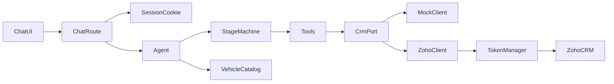
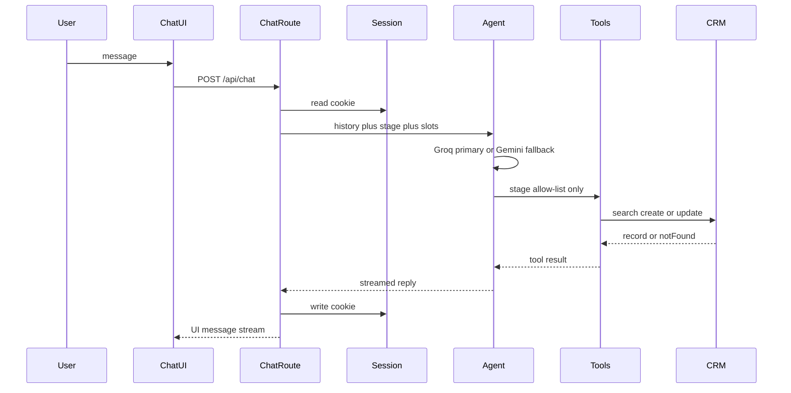

# Architecture

Single Next.js App Router service. No separate Express/Nest backend.

## One turn

## Layout

| Path | Role |
|---|---|
| `src/app/page.tsx` | Chat UI |
| `src/app/api/chat/route.ts` | Stream one turn |
| `src/app/api/session/route.ts` | Read current stage/slots |
| `src/agent/*` | Prompt, stages, tools, run |
| `src/catalog/vehicles.ts` | Demo prices and facts |
| `src/crm/*` | Mock / Zoho CRM port |
| `src/session/*` | Signed cookie session |

## LLM

- Primary: Groq `openai/gpt-oss-120b` (`GROQ_API_KEY`) — model id must match what the key can list
- Secondary: Gemini `gemini-3.5-flash` when Groq is missing or fails

## Security

- Server-only secrets. No `NEXT_PUBLIC_` keys.
- CRM writes only after Zod validation in tool handlers.
- `CRM_MODE=mock` refused when `NODE_ENV=production`.
- In-memory rate limit on `/api/chat` per session.
- Pre-commit: `secrets:check` (pattern scan + block `.env*`) and `audit:check` (production `npm audit`, high+).
