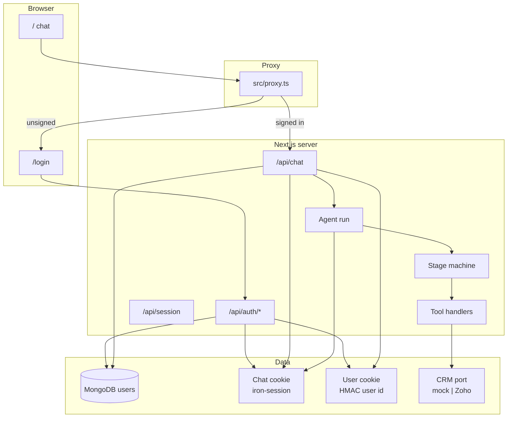
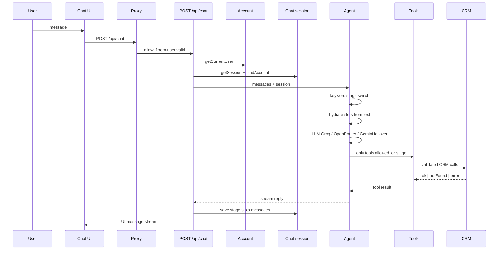
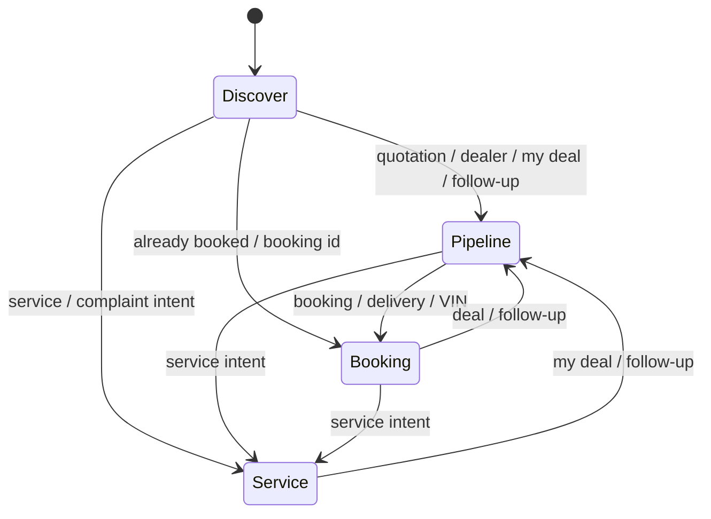

# Architecture

Single Next.js App Router app: chat UI, signed-in accounts (MongoDB), and a four-stage sales/service agent. CRM is mock or Zoho behind one port. No separate API server.

## System view

## Authentication and identity

| Piece | Role |
|---|---|
| `src/proxy.ts` | Blocks `/` and `/api/*` (except `/api/auth/*`) until `oem-user` cookie is valid. Redirects to `/login`. |
| MongoDB `users` | `email`, `name`, scrypt `passwordHash` only. |
| `oem-user` cookie | HttpOnly; stores signed **user id only** (not email in the cookie payload). |
| `oem-chat-session` cookie | HttpOnly iron-session: **stage**, CRM ids, chat slots, message history. |
| `bindAccount` | On each chat/session request: loads user from MongoDB, copies `name` and `email` onto the chat session. Demo date/time stay on the chat cookie only (or CRM lead after `createLead`). |

Register or login → both cookies are set → chat opens. **Sign out** clears both. **New chat** wipes CRM/thread slots and demo date/time on the chat cookie but keeps the account identity.

Env: `MONGODB_URI`, `MONGODB_DB` (default `mahindra`), `SESSION_SECRET` (≥32 chars; signs chat session and user token).

## One chat turn

Rate limits: `/api/chat` per `userId`; login/register per endpoint (in-memory, per instance).

## Four stages

Stages live in `src/agent/stages.ts`. The model sees the current stage and an **allow-list** of tools; handlers enforce the same list. Stage can change when the user’s message matches explicit keywords (ambiguous messages stay on the current stage).

### Discover — explore and capture interest

**Purpose:** Answer product questions from the catalog and create a **new** lead when the customer wants a test drive or to proceed.

| | |
|---|---|
| **Typical asks** | Price, features, variants (XUV700, Thar, Scorpio-N), “book a test drive”, availability in a city |
| **Catalog** | `src/catalog/vehicles.ts` — only source of ex-showroom prices and feature copy |
| **CRM tool** | `createLead` |
| **When `createLead` is allowed** | Stage is Discover **and** session has `name`, `phone`, `email`, `city`, and `vehicle` (often pre-filled from the signed-in account for name/email) |
| **Writes** | Lead in CRM; optional demo **date** (`YYYY-MM-DD`) and **time** (`HH:MM`) on lead `Description` and chat session slots |
| **Stays here** | Pure Q&A without CRM write; collecting missing fields via chat or `[[collect:lead:...]]` form |

New test-drive intent does **not** jump to Pipeline; Pipeline is for **existing** deals.

### Pipeline — existing deal and follow-up

**Purpose:** Find an open deal and reschedule or note follow-up (e.g. test-drive date).

| | |
|---|---|
| **Typical asks** | “My deal”, quotation, dealer, follow-up, reschedule test drive |
| **CRM tools** | `lookupDeal` (phone or deal id), `updateFollowUp` |
| **Writes** | Deal `Test_Drive_Time` (date); clock time and notes in `Description` |
| **Demo seed** | Priya Patel, `+919800000002`, XUV700 deal |

If lookup returns `notFound`, ask for the other identifier (phone vs deal id).

### Booking — post-booking status

**Purpose:** Status for a confirmed booking (allocation, VIN, balance link).

| | |
|---|---|
| **Typical asks** | Booking id (e.g. `MAH-9921`), delivery, VIN, balance payment |
| **CRM tool** | `lookupBooking` (booking id and/or phone) |
| **Status words** | Only: `In Transit`, `Dispatch Pending`, `Delivered` |
| **Quotes** | VIN and balance URL only if returned from CRM — never invented |
| **Demo seed** | Amit Verma / `MAH-9921`, `In Transit`, sample VIN and balance URL |

### Service — workshop and complaints

**Purpose:** Log a service case after the vehicle and visit details are known.

| | |
|---|---|
| **Typical asks** | Periodic service interval (catalog first), complaint, book maintenance |
| **CRM tool** | `createServiceCase` |
| **Required slots** | Registration, odometer, issue/service type, preferred center (and phone/contact when needed) |
| **Writes** | Zoho Case linked to Contact when possible |
| **Demo seed** | Sunil Rao, reg `MH04 AB 1234` |

### Tool allow-list by stage

| Stage | Tools exposed to the model |
|---|---|
| Discover | `createLead` (only when lead + vehicle slots complete) |
| Pipeline | `lookupDeal`, `updateFollowUp` |
| Booking | `lookupBooking` |
| Service | `createServiceCase` |

Implementation: `buildTools` in `src/agent/tools.ts` + `toolsForSession` in `src/agent/stages.ts`. Prompt rules in `src/agent/prompt.ts`.

## Code layout

| Path | Role |
|---|---|
| `src/app/page.tsx`, `src/components/chat.tsx` | Chat shell (header + assistant card) |
| `src/app/login/page.tsx`, `src/components/login-form.tsx` | Sign-in / register |
| `src/proxy.ts` | Auth gate |
| `src/app/api/auth/*` | Login, register, logout |
| `src/app/api/chat/route.ts` | Stream one turn (auth required) |
| `src/app/api/session/route.ts` | Stage badge + slots; reset chat |
| `src/auth/*`, `src/db/mongo.ts` | Users, passwords, cookies, `bindAccount` |
| `src/session/*` | Chat cookie types and wipe helpers |
| `src/agent/*` | Prompt, stages, tools, `run.ts` |
| `src/catalog/vehicles.ts` | Demo vehicle facts |
| `src/crm/*` | Mock and Zoho clients |
| `src/lib/test-drive-time.ts` | Parse demo / test-drive phrases → date + time |

## LLM

- Order: Groq `openai/gpt-oss-120b` → OpenRouter (default `meta-llama/llama-3.3-70b-instruct`) → Gemini
- First keyed provider is primary; others used on request failure (`src/agent/model.ts`)

## Security

- Server-only secrets; no `NEXT_PUBLIC_*` for keys.
- CRM writes only through Zod-validated tool `execute` handlers.
- `CRM_MODE=mock` throws in production.
- Do not log phone, email, booking ids, or registration numbers.
- Pre-commit: `secrets:check`, `audit:check` (high+).

Further detail: [Session](session.md), [Stages](stages.md) (transitions + seeds), [Zoho setup](zoho-setup.md), [Deploy on Vercel](deploy-vercel.md).
