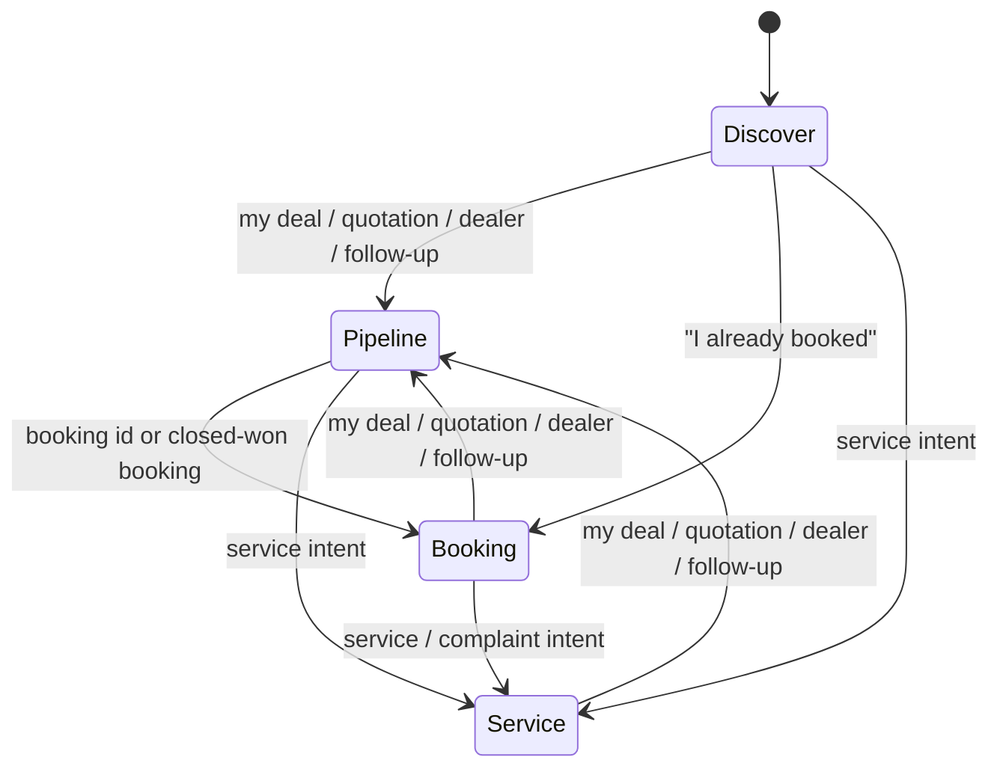

# Stages

Four-stage flow: **Discover → Pipeline → Booking → Service**. Rules and diagrams are in [Architecture](architecture.md#four-stages). This page is a short reference.

## Session fields used across stages

`stage`, `userId`, `leadId`, `dealId`, `bookingId`, `contactId`, `phone`, `name`, `email`, `city`, `vehicle`, `demoDate`, `demoTime`, `pendingSlots`, `messages`.

After login, `name` and `email` usually come from MongoDB; the agent still collects phone, city, and vehicle for a new lead.

## Transitions

Keyword-based switches in `src/agent/stages.ts` (`detectStageSwitch`). If nothing matches, stage unchanged.

## Per stage (summary)

| Stage | Goal | Tools |
|---|---|---|
| **Discover** | Catalog Q&A; create lead + demo schedule when slots complete | `createLead` |
| **Pipeline** | Find deal; reschedule / notes | `lookupDeal`, `updateFollowUp` |
| **Booking** | Allocation, VIN, balance URL from CRM | `lookupBooking` |
| **Service** | Open service case | `createServiceCase` |

## Mock / seed pointers

| Stage | Try in chat |
|---|---|
| Discover | “XUV700 ex-showroom price?” then lead flow |
| Pipeline | “My deal — phone +919800000002” |
| Booking | “Booking MAH-9921 status” |
| Service | “Service for MH04 AB 1234” |

Use **New chat** between scenarios; account stays signed in.
