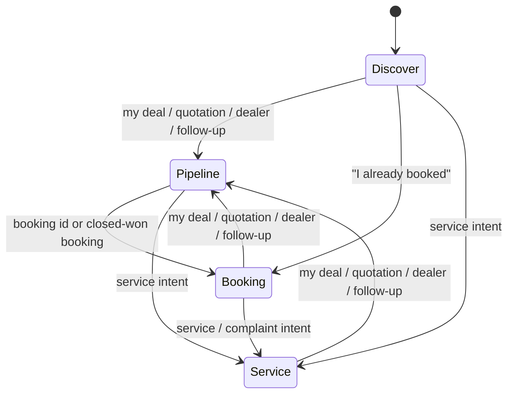

# Stages

Session fields: `stage`, `leadId`, `dealId`, `bookingId`, `contactId`, `phone`, `name`, `email`, `city`, `vehicle`, `pendingSlots`, `messages`.

Ambiguous turns stay on the current stage and ask one clarifying question. Explicit customer intent can switch stage.

## Discover

- Triggers: model, price, features, new test-drive request, unknown customer.
- Tools: `createLead` (only after name, phone, email, city).
- Zoho: create Lead; vehicle in `ZOHO_VEHICLE_FIELD` (default `Vehicle_Model`).
- Prices only from `src/catalog/vehicles.ts` (XUV700, Thar, Scorpio-N).
- New “book a test drive” stays here so lead fields can be collected.

## Pipeline

- Triggers: phone or deal context, quotation, dealer, my deal, follow-up (existing prospect).
- Tools: `lookupDeal`, `updateFollowUp`.
- Zoho: search/update Deals (follow-up notes append to Description).
- Seed: Priya Patel, XUV700, phone `+919800000002`.

## Booking

- Triggers: booking id (e.g. `MAH-9921`) or phone, delivery, VIN, balance.
- Tools: `lookupBooking`.
- Status vocabulary only: `In Transit`, `Dispatch Pending`, `Delivered`.
- Quote VIN and balance payment URL only from CRM fields on the booking deal.
- If neither id matches, ask for the other. Never fabricate.
- Seed: Amit Verma / `MAH-9921`, Allocation_Status `In Transit`, demo `VIN` + `Balance_Payment_URL`.

## Service

- Triggers: complaint, service interval, maintenance slot.
- Tools: `createServiceCase` after registration, odometer, issue/service type, preferred center.
- Interval Q&A uses catalog facts first; open a case only for slot/complaint.
- Zoho: Cases linked to Contact.
- Seed owner: Sunil Rao, reg `MH04 AB 1234`.

## Tool allow-list

| Stage | Tools |
|---|---|
| Discover | `createLead` |
| Pipeline | `lookupDeal`, `updateFollowUp` |
| Booking | `lookupBooking` |
| Service | `createServiceCase` |
